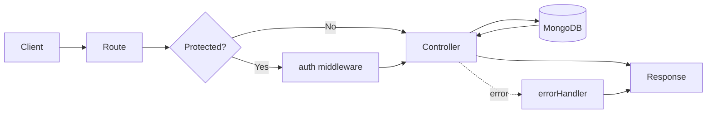
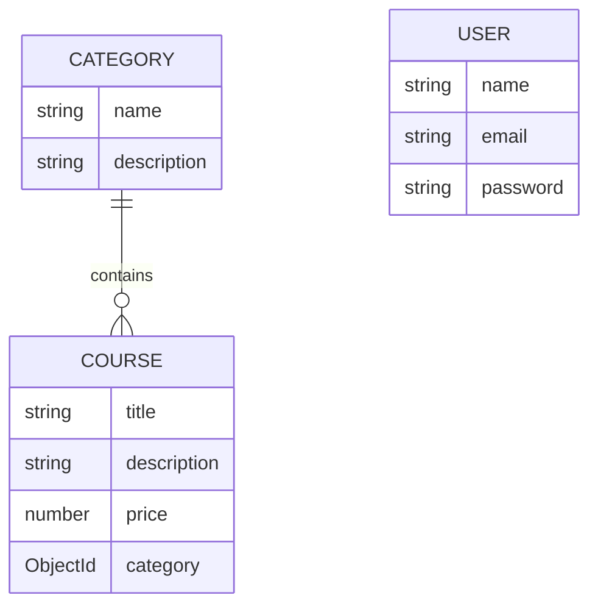

<div align="center">

# 🎓 Course API

### A clean, modular REST API for courses & categories — built with Express, MongoDB and JWT.

<br />


<br />

[**Quick Start**](#-quick-start) •
[**Endpoints**](#-api-endpoints) •
[**Examples**](#-request-bodies) •
[**Structure**](#-project-structure) •
[**Author**](#-author)

</div>

---

## ✨ Features

- 🔐 **JWT authentication** — register, login and a protected `/me` route
- 📚 **Full CRUD** for **categories** and **courses**
- 🔗 **Relational data** — every course belongs to a category, filterable via `?category=<id>`
- 🧱 **Modular MVC structure** — models, controllers, routes and middleware cleanly separated
- 🛡️ **Centralised error handling** with `asyncHandler` + `errorHandler` middleware
- ✅ **Proper HTTP status codes** across every endpoint

---

## 🧰 Tech Stack

| Layer | Technology |
|:------|:-----------|
| Runtime | Node.js |
| Framework | Express.js |
| Database | MongoDB + Mongoose |
| Auth | JSON Web Tokens (JWT) |
| Architecture | MVC |

---

## 🚀 Quick Start

```bash
# 1. Install dependencies
npm install

# 2. Create your environment file
cp .env.example .env        # Windows: copy .env.example .env

# 3. Start the dev server
npm run dev
```

> [!IMPORTANT]
> Make sure MongoDB is running locally, or put a **MongoDB Atlas** connection string in `MONGO_URI` inside your `.env`.

---

## 🗂️ Project Structure

```text
📦 course-api
├── 📄 server.js
└── 📁 src
    ├── 📄 app.js
    ├── 📁 config
    │   └── 📄 db.js
    ├── 📁 models
    │   ├── 📄 User
    │   ├── 📄 Category
    │   └── 📄 Course
    ├── 📁 controllers
    │   ├── 📄 authController
    │   ├── 📄 categoryController
    │   └── 📄 courseController
    ├── 📁 routes
    │   ├── 📄 authRoutes
    │   ├── 📄 categoryRoutes
    │   └── 📄 courseRoutes
    └── 📁 middleware
        ├── 📄 auth
        ├── 📄 asyncHandler
        └── 📄 errorHandler
```

### 🔄 Request lifecycle



### 🧬 Data model



---

## 📡 API Endpoints

> 🔒 = requires `Authorization: Bearer <token>`

### 🔑 Auth

| Method | Endpoint | Auth | Description |
|:------:|:---------|:----:|:------------|
|  | `/api/auth/register` | — | Register a user, returns a token |
|  | `/api/auth/login` | — | Login, returns a token |
|  | `/api/auth/me` | 🔒 | Get the current user |

### 🗃️ Categories

| Method | Endpoint | Auth | Description |
|:------:|:---------|:----:|:------------|
|  | `/api/categories` | 🔒 | Create a category `201` |
|  | `/api/categories` | — | List all categories `200` |
|  | `/api/categories/:id` | — | Get one category |
|  | `/api/categories/:id` | 🔒 | Update a category |
|  | `/api/categories/:id` | 🔒 | Delete a category |

### 📘 Courses

| Method | Endpoint | Auth | Description |
|:------:|:---------|:----:|:------------|
|  | `/api/courses` | 🔒 | Create a course |
|  | `/api/courses` | — | List courses (`?category=<id>` to filter) |
|  | `/api/courses/:id` | — | Get one course |
|  | `/api/courses/:id` | 🔒 | Update a course |
|  | `/api/courses/:id` | 🔒 | Delete a course |

---

## 📨 Request Bodies

<details open>
<summary><b>🔑 Register</b> — <code>POST /api/auth/register</code></summary>

```json
{
  "name": "Muhammad Furqan",
  "email": "furqan@example.com",
  "password": "123456"
}
```

</details>

<details>
<summary><b>🔓 Login</b> — <code>POST /api/auth/login</code></summary>

```json
{
  "email": "furqan@example.com",
  "password": "123456"
}
```

</details>

<details>
<summary><b>🗃️ Create category</b> — <code>POST /api/categories</code></summary>

```json
{
  "name": "Web Development",
  "description": "Frontend and backend courses"
}
```

</details>

<details>
<summary><b>📘 Create course</b> — <code>POST /api/courses</code></summary>

```json
{
  "title": "Node.js Basics",
  "description": "Intro to Node",
  "price": 49,
  "category": "<categoryId>"
}
```

</details>

---

## 🧪 Try It Out

```bash
# Register and grab your token
curl -X POST http://localhost:5000/api/auth/register \
  -H "Content-Type: application/json" \
  -d '{"name":"Muhammad Furqan","email":"furqan@example.com","password":"123456"}'

# Use the token on protected routes
curl -X POST http://localhost:5000/api/categories \
  -H "Content-Type: application/json" \
  -H "Authorization: Bearer <token>" \
  -d '{"name":"Web Development","description":"Frontend and backend courses"}'

# Filter courses by category
curl "http://localhost:5000/api/courses?category=<categoryId>"
```

> [!NOTE]
> Adjust the port to match the value in your `.env`.

---

## 🚦 Status Codes

| Code | Meaning | When |
|:----:|:--------|:-----|
|  | **OK** | Successful read / update / delete |
|  | **Created** | Resource created |
|  | **Bad Request** | Validation failed |
|  | **Unauthorized** | Missing or invalid token |
|  | **Not Found** | Resource doesn't exist |

---

## 👨‍💻 Author

<div align="center">

**Muhammad Furqan** — Frontend Software Engineer · Lahore, Pakistan

[](https://furqannewportfolio.netlify.app)
[](https://github.com/furqanzubair209-cell)
[](https://www.linkedin.com/in/muhammad-furqan-228807304)

<br />

⭐ **If this project helped you, consider giving it a star!** ⭐

</div>
